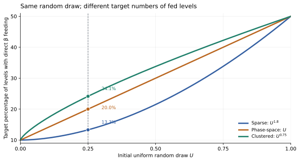
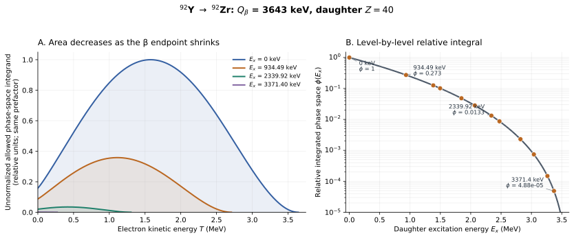
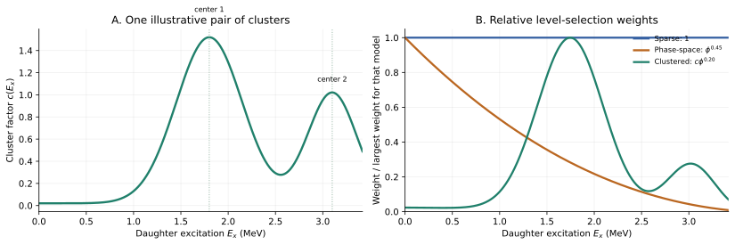
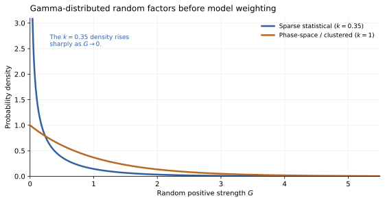
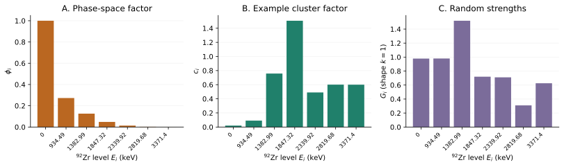
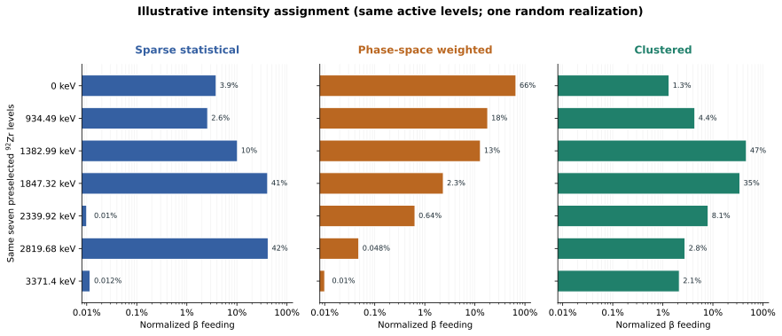

# Statistical β-feeding models

**Implementation:** MTAS Simulation Library v1.2.3, `src/apps/GenerateDecaySchemes.cpp` (`PhaseSpace`, `ChooseBetaModel`, `DrawFedFraction`, `ClusterWeights`, `AssignBeta`). Source SHA-256: `889ab065aa1f26f2ace49059f8b404d082850693975212594aa89774d78a360f`.

This chapter explains **how the program invents plausible *integrated β feeding* for hypothetical daughter levels**. It does *not* explain the energy distribution of the emitted β electrons: that is a separate calculation performed by `GenerateResponse` ([β-electron spectra](BetaSpectra.md)).

The currently available models are deliberately **phenomenological**. They generate a variety of hypothetical decay schemes; they are not calculations of nuclear matrix elements or predictions of the true feeding of an individual nucleus.

## The task: how do we invent a β-feeding distribution?

Suppose a daughter nucleus has **100 possible energy levels**, including its ground state. We need to decide:

1. **How many** of the 100 levels should receive direct β feeding? For example, 20.
2. **Which** 20 levels should receive it? Should lower-energy levels be favored, or should levels appear in clusters?
3. **How much** β intensity should each of the 20 levels receive? The intensities must be positive and sum to 100%.

Those are separate statistical operations. They happen in this order:

```text
Fixed daughter-level skeleton (level energies)
          |
          v
1. Choose a target NUMBER of beta-fed levels
          |
          v
2. Choose WHICH levels are beta-fed
          |
          v
   Apply mandatory experimental-level constraints
          |
          v
3. Draw a positive raw intensity for EACH selected level
          |
          v
4. Normalize to 100% and enforce the minimum intensity
          |
          v
   Write randomized beta feeding to the decay-scheme XML
```

The skeleton itself is constructed **once per generator run** and shared by its variations. It contains experimental daughter levels in the trusted region and, where configured, added effective levels on the nonuniform MTAS energy grid. Every level has an energy \(E_i\); the subscript \(i\) is simply its index in the ordered list, starting with \(i=0\) for the ground state.

### The models at a glance

| Model (`beta.model`) | Typical number of fed levels | Which levels tend to be selected? | Which selected levels tend to get more intensity? | Random-strength shape \(k\) |
|---|---|---|---|---:|
| `sparse_statistical` | Fewer | All eligible levels equally likely | Highly uneven random intensities; no phase-space preference | **0.35** |
| `phase_space_weighted` | Uniformly distributed over the configured range | Prefer larger available β phase space (usually lower excitation energy) | Prefer larger available β phase space | **1** |
| `clustered` | More | Prefer random regions of excitation energy, with a weak phase-space bias | Prefer those regions, with a weak phase-space bias | **1** |
| `mixed` | Depends on selected model | Depends on selected model | Depends on selected model | 0.35 or 1 |

`mixed` **selects one of the other three models with equal probability for each attempted variation**. It does not average their intensities together within one scheme.

The following sections explain the shared steps first, rather than repeating the whole algorithm separately for each model.

## Step 1 — Decide how many levels receive β feeding

The configuration defines a lower and upper *fraction* of levels to feed. For example:

```ini
[beta]
model = mixed
fed_fraction_mode = model_dependent
fed_fraction_min = 0.10
fed_fraction_max = 0.50
```

With 100 levels, the nominal target is somewhere between **10 and 50 directly β-fed levels**.

First, the generator draws a random number \(U\) **uniformly between 0 and 1**. Next, it transforms that number to obtain the requested fraction:

\[
f_{\mathrm{draw}}=f_{\min}+(f_{\max}-f_{\min})g(U).
\]

Here, \(f_{\min}=0.10\) and \(f_{\max}=0.50\) in our example. The function \(g(U)\) depends on the model:

| Model | Transformation \(g(U)\) | Effect |
|---|---|---|
| Sparse statistical | \(U^{1.8}\) | Shifts random fractions toward the lower end |
| Phase-space weighted | \(U\) | Leaves the fractions uniformly distributed |
| Clustered | \(U^{0.75}\) | Shifts random fractions toward the upper end |

**The superscript is an exponent.** \(U^{1.8}\) means “take the random number \(U\) and raise it to the power 1.8.” For values between 0 and 1, a power greater than 1 makes them smaller; a power less than 1 makes them larger.



*Example:* Suppose the same initial random draw is \(U=0.25\). The three target fractions are 13.3%, 20.0%, and 24.1%, respectively. With 100 levels, that means about **13, 20, or 24 levels**. The plot marks those three results. The numerical powers **1.8** and **0.75** are chosen phenomenological parameters, not nuclear-physics constants.

If `fed_fraction_mode = uniform`, all models instead use \(g(U)=U\). This changes **how many** levels are requested, not the model-specific rules for **which** levels or **how much** feeding.

The code rounds \(n f_{\mathrm{draw}}\) (where \(n\) is the total number of skeleton levels, **including the ground state**), applies the configured count limits, and respects experimentally mandatory feeding. Protected γ-only levels are excluded. Because of the mandatory levels and the preservation rules discussed below, the final number of β-fed levels can differ from this initial target.

## A shared ingredient: how β phase space enters

We need one more quantity before choosing particular levels. Two models use the available β-decay **phase space** to express a preference for lower or higher daughter excitation energies; the sparse model does not use this preference.

### The physical motivation

For a transition to daughter level \(i\), the available β endpoint is

\[
q_i=Q_\beta-E_i,
\]

where \(Q_\beta\) is the decay energy and \(E_i\) is the daughter excitation energy. As \(E_i\) increases, the electron and antineutrino have less energy available.

In an allowed-decay approximation, the *integrated kinematic part* of the β transition rate is proportional to

\[
I_i=\int_{0}^{q_i}
       p(T)W(T)(q_i-T)^2F(Z_d,T)\,dT,
\]

where \(T\) is electron kinetic energy, \(W=T+m_e\) is total electron energy, \(p=\sqrt{T(T+2m_e)}\) is electron momentum in energy units, and \(F\) is an approximate Coulomb/Fermi factor for daughter charge \(Z_d\). The expression ignores nuclear matrix elements: it is **not** an evaluated β-feeding intensity. For the precise approximation and numerical prescription used by the code, see [Implementation details](#implementation-details-the-exact-phase-space-calculation) below.

### Why divide by the largest integral?

The code calculates \(I_i\) **for every level in the fixed skeleton**, and forms a *relative* factor

\[
\boxed{\phi_i = \frac{I_i}{I_{\max}}},
\qquad I_{\max}=\max_j I_j.
\]

(For numerical stability, the code bounds positive model weights below by \(10^{-15}\).) Because the ground state is included, it ordinarily has the largest integral: \(\phi_{\mathrm{g.s.}}=1\). Higher daughter states generally have \(\phi_i<1\).

**This is not yet a probability of selecting a level.** Dividing by the largest value simply puts the different phase-space integrals on a convenient dimensionless scale. Later, the program uses these relative factors as parts of *selection weights* and *intensity weights*.

### Worked example: \(^{92}\mathrm{Y}\to{}^{92}\mathrm{Zr}\)

The example uses **\(Q_\beta=3643\) keV and \(Z_d=40\)** from the supplied \(^{92}\mathrm{Y}\) XML input, and the energy levels in the supplied \(^{92}\mathrm{Zr}\) XML file. The curves and values were calculated using the same **160-point midpoint integration** and approximate Fermi factor as `GenerateDecaySchemes.cpp`.



**Read the figure from left to right:**

- **Left:** The four electron-energy curves have different endpoints. **Area under a curve** is proportional to the corresponding integral \(I_i\). The curves are *not* separately normalized to unit area. That is why the ground-state curve has much more area than the curve for a high excited state.
- **Right:** Each integral is divided by the largest one, giving \(\phi_i\). Orange points identify the known daughter levels; the gray curve is calculated between them to guide the eye. A logarithmic vertical scale makes the strongly suppressed high-energy tail visible.

| \(^{92}\mathrm{Zr}\) excitation \(E_i\) (keV) | β endpoint \(q_i\) (keV) | Relative integral \(\phi_i\) |
|---:|---:|---:|
| 0.00 | 3643.00 | 1.000000 |
| 934.49 | 2708.51 | 0.272599 |
| 1382.99 | 2260.01 | 0.125772 |
| 1847.32 | 1795.68 | 0.048213 |
| 2339.92 | 1303.08 | 0.013266 |
| 2819.68 | 823.32 | 0.002297 |
| 3371.40 | 271.60 | 0.00004883 |

The 2339.92-keV level has only about **1.33%** of the ground-state integrated phase-space proxy. That does **not** mean its actual β feeding must be 1.33% of the ground-state feeding: the nuclear transition strengths are unknown. The statistical model uses \(\phi_i\) as a phenomenological preference.

## Step 2 — Decide *which* levels are β-fed

Suppose Step 1 asks for 20 β-fed levels. The program now selects them one at a time, **without replacement**. After selecting one level, it is removed from the pool before the next selection.

Every still-eligible level \(i\) gets a positive *selection weight* \(s_i\). On a particular draw, its probability of being chosen is

\[
P(i\;\text{chosen next}) = \frac{s_i}{\sum_{j\in A}s_j},
\]

where \(A\) is the set of currently eligible levels. **The symbols \(i\) and \(j\) are level indices**, not different kinds of physical quantities. The denominator sums the weights of all currently eligible levels.

| Model | Weight used to choose a level \(s_i\) | What it favors |
|---|---|---|
| Sparse statistical | \(1\) | All eligible levels equally |
| Phase-space weighted | \(\phi_i^{0.45}\) | Levels with larger relative β phase space |
| Clustered | \(c_i\phi_i^{0.20}\) | Levels near randomly sampled excitation-energy clusters, with a weak phase-space preference |

For example, consider three eligible \(^{92}\mathrm{Zr}\) levels at 0, 934.49, and 2339.92 keV. Their relative phase spaces are \(1\), \(0.2726\), and \(0.01327\). Under the phase-space model, the weights are

\[
s_i=\phi_i^{0.45}\simeq (1,\,0.557,\,0.143).
\]

After normalizing **those three** weights to obtain a probability for *the next draw*, the probabilities are about **58.8%, 32.8%, and 8.4%**. These are not their β-decay intensities. This simple three-level example illustrates a single selection; the real calculation includes all eligible levels and updates the denominator after each selection.

### Why use \(\phi^{0.45}\) rather than \(\phi\)?

For \(0<\phi<1\), a power smaller than one makes the number larger. For example,

\[
0.01^{0.45}\approx0.126.
\]

That greatly reduces the suppression of levels with small phase space. The exponent **0.45** is an empirical *model design choice* to retain appreciable variety at high excitation energies, not a known nuclear constant.

### How the clustered model chooses preferred energies

For every attempted clustered variation, the generator draws **1, 2, or 3 clusters**, each described by a random center \(\mu_k\), width \(\sigma_k\), and amplitude \(A_k\). It calculates the cluster factor

\[
c_i=0.02+\sum_{k=1}^{K} A_k
\exp\!\left[-\frac{(E_i-\mu_k)^2}{2\sigma_k^2}\right].
\]

The 0.02 baseline prevents the cluster preference from becoming zero far from the chosen peaks. The code draws \(\mu_k\) uniformly between 0 and \(Q_\beta\), \(\sigma_k\) uniformly between 200 and 1300 keV, and \(A_k\) uniformly between 0.3 and 2.0.



In this **illustrative** two-cluster example (centers at 1800 and 3100 keV), the selection weights on the right follow the exact three formulas in the table above. Each curve has been divided by its own maximum **for display only**; the actual program normalizes over eligible levels when it makes each draw.

Again, \(\phi_i^{0.20}\) is a *weaker* phase-space preference than \(\phi_i\), while \(c_i\) provides the desired concentration around selected energies. Cluster centers are **not** claims about nuclear bands or physical level structures.

## Step 3 — Assign *how much* β feeding each selected level receives

We now know **which levels have nonzero direct β feeding**. But they still have no assigned feeding intensities.

For each selected level \(i\), the generator draws an independent, positive random number \(G_i\). These numbers are sampled from the **gamma probability distribution**, which is a mathematical distribution of positive random variables—it has **nothing to do with γ rays**.

The distribution's shape is called \(k\) and its scale is 1:

\[
G_i\sim\operatorname{Gamma}(k,1).
\]

| Model | Shape \(k\) | Consequence |
|---|---:|---|
| Sparse statistical | **0.35** | Many very small random strengths, with occasional much larger ones |
| Phase-space weighted | **1** | Exponential random strengths; less sharply concentrated near zero |
| Clustered | **1** | **Same initial random-strength distribution** as phase-space weighted |

**Yes: the shape parameter changes only for `sparse_statistical`.** The other two models both use \(k=1\). The difference between those two arises from which other factors multiply \(G_i\), not from a different gamma distribution.



### Multiplying the random draws by model factors

After sampling \(G_i\), the code forms the **raw, unnormalized** strength \(a_i\):

| Model | Raw intensity for a selected level \(i\) |
|---|---|
| Sparse statistical | \(a_i=G_i\) |
| Phase-space weighted | \(a_i=G_i\phi_i\) |
| Clustered | \(a_i=G_i c_i\phi_i^{0.25}\) |

This is a **different use** of the phase-space factor from Step 2:

- In **Step 2**, \(\phi_i^{0.45}\) or \(\phi_i^{0.20}\) influences **whether a level is selected**.
- In **Step 3**, \(\phi_i\) or \(\phi_i^{0.25}\) influences **how large its feeding is once selected**.

The specific powers (0.45, 0.20, and 0.25) were chosen independently as phenomenological weights; there is no derivation requiring those particular numbers. A power below 1 weakens the tendency to suppress large excitation energies.

### Worked example: seven preselected \(^{92}\mathrm{Zr}\) levels

To separate *level selection* from *intensity assignment*, imagine that the **same seven daughter levels** have already been selected in all three models. This is an illustrative calculation, **not an actual generator output** and not measured feeding for \(^{92}\mathrm{Y}\).

We use the actual \(^{92}\mathrm{Y}\) phase-space factors from the table above. For the clustered model, we use the illustrated two-cluster function from Step 2. We draw one set of \(k=0.35\) random factors for sparse statistical, and one set of \(k=1\) random factors reused for both phase-space and clustered examples; doing the latter makes their differing multipliers easier to compare.



For each model, multiply these ingredients according to the raw-strength table, **then normalize the selected levels to a total of 100%** (including the configured minimum-positive-branch rule). The result is:



**How to interpret this comparison:**

- **Sparse statistical:** There is no phase-space multiplier; the unevenness comes from the \(k=0.35\) random draws. Consequently, high-energy states *can* receive large feeding.
- **Phase-space weighted:** The raw strengths are multiplied by \(\phi_i\). High-energy states are usually strongly suppressed because their phase-space factors are small.
- **Clustered:** The random strengths are multiplied by \(c_i\phi_i^{0.25}\). The clusters can move feeding toward selected energy regions, and the small exponent makes the phase-space suppression weaker.

The horizontal axes are **logarithmic**, so even small branches remain visible. In this particular example, the 0.01% floor is reached by one branch in the sparse model and one in the phase-space model. Another random draw would produce different bars; the point is to show how the *rules* differ, not to assert a characteristic branching pattern for \(^{92}\mathrm{Y}\).

## Step 4 — Normalize the intensities and apply the positive-branch minimum

Without an intensity floor, the normalized β feeding of selected level \(i\) would be

\[
b_i=\frac{a_i}{\sum_{j\in B}a_j},\qquad \sum_{i\in B}b_i=1,
\]

where \(B\) is the set of selected β-fed levels. The XML writes **\(100b_i\)** as an intensity percentage. Nonselected levels retain **exactly zero β feeding**.

The configuration normally also requires that *every nonzero* β branch be at least 0.01%:

```ini
min_intensity_percent = 0.01
```

To satisfy that, the program fixes any active branch that would fall below 0.01% at the floor, then proportionally rescales the other active branches. It repeats until all positive branches satisfy the floor and still sum to 100%. **It does not add 0.01% to every branch.** If there are so many active levels that the minimum cannot fit inside 100%, the candidate variation is rejected.

## Experimental information and other constraints

The steps above describe the statistical model; the production generator also respects its experimental and graph constraints:

- **Known β-fed levels:** With `keep_known_beta_fed_nonzero=true`, every experimentally known *positive* feeding that is retained in the skeleton remains positive, but its **intensity is redrawn**. Thus this setting preserves the *presence* of the feeding branch, not its published percentage.
- **Known γ structure:** With `freeze_known_gamma_patterns=true`, both the known transition destinations and their γ branching fractions are retained. Certain frozen γ links may require additional levels to be promoted to direct β feeding so that no unintended γ-only-fed levels are introduced. The final fed-level count can therefore exceed the sampled target.
- **γ-only-fed levels:** Experimentally inherited γ-only-fed excited levels can be protected from acquiring direct β feeding; explicitly generated special γ-only-fed levels are treated separately. See [γ-transition generation](GammaTransitionModels.md#gamma-only-fed-excited-levels).
- **Rejected draws:** Inconsistent attempts are retried up to the configured `run.max_attempts_per_variation`; the program does not quietly rewrite the model parameters to make a bad draw valid.

These rules matter when interpreting one particular generated decay scheme. The selection/intensity figures above deliberately leave them aside to make the statistical differences visible.

## Implementation details: the exact phase-space calculation

For readers who want to reproduce \(\phi_i\) numerically, `PhaseSpace()` uses the following **allowed β− approximation**, with all energies in keV:

\[
\begin{aligned}
W(T)&=T+m_e,&m_e&=510.99895,\\
p(T)&=\sqrt{T(T+2m_e)},\\
\eta(T)&=\alpha Z_d\frac{W(T)}{p(T)},&\alpha&=\frac{1}{137.035999084},\\
F(Z_d,T)&=\frac{2\pi\eta(T)}{1-\exp[-2\pi\eta(T)]}.
\end{aligned}
\]

The integral is approximated by **160 midpoint samples**:

\[
I_i\simeq\frac{q_i}{160}\sum_{r=0}^{159}
\underbrace{p(T_r)W(T_r)(q_i-T_r)^2F(Z_d,T_r)}_{\text{unnormalized β phase-space integrand}},
\quad T_r=\frac{q_i(r+1/2)}{160}.
\]

The code uses `expm1` for numerical stability in the Fermi factor, sets \(I_i=0\) for nonpositive endpoints, and uses \(\max(10^{-15},I_i/I_{\max})\) as the operative relative weight when \(I_{\max}>0\). This simplified Coulomb factor does not include finite-size corrections, screening, nonallowed shape factors, or nuclear transition strengths. **It is a generator weight, not a physical β-intensity prediction.**

For completeness, the gamma-distribution probability density used for the independent \(G_i\) draws (unit scale) is

\[
f(G;k)=\frac{G^{k-1}e^{-G}}{\Gamma(k)},\qquad G>0.
\]

Here \(\Gamma(k)\) denotes the mathematical gamma **function**, and is not a nuclear γ transition. The shape values \(k=0.35\) and \(k=1\) are fixed in the v1.2.3 code. The numerical random-strength example above uses a fixed illustrative Python seed (20261125) and the same mathematical distributions and weighting rules, **not** a replay of the C++ generator's random-number sequence.

## Summary: what is physical, and what is a model choice?

The available β endpoint and the phase-space integral have a real physical motivation. **How we turn them into statistical priors does not follow uniquely from nuclear physics.** The fed-fraction powers 1.8 and 0.75, the phase-space powers 0.45, 0.20, and 0.25, the cluster ranges, and the random-strength shapes are intentional **phenomenological choices** used to diversify the library of hypothetical schemes. New models can be added later without changing what these existing models mean.

**Further reading:** [γ-transition models](GammaTransitionModels.md), [complete scheme construction and validation](DecaySchemeValidation.md), [the generator program](../programs/GenerateDecaySchemes.md), [configuration reference](../reference/Configurations.md), and [β-electron spectra](BetaSpectra.md).
