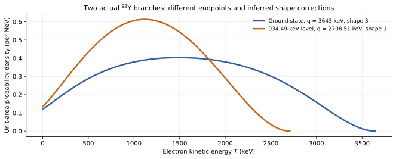
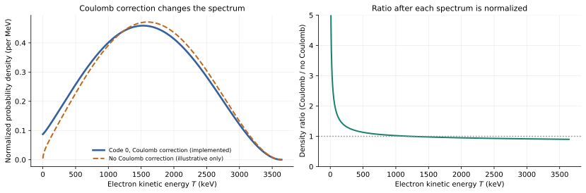
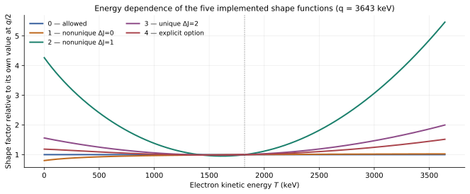
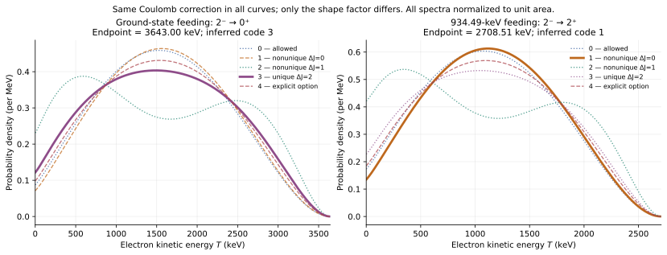

# β− electron spectra: endpoint, Coulomb correction, and shape factors

**Implemented in:** MTAS Simulation Library v1.2.3, `src/apps/GenerateResponse.cpp` (`InferredShape`, `ShapeFactor`, `LogEulerGammaProduct`, `BetaDensity`, `BetaSampler`, `NearestLibraryEnergy`). Verified source SHA-256: `07604a85e0957161395491cbfa233e60538a47113d80d2c077b778fa23c0a2e6`. The figures here are calculated from those functions and the supplied **⁹²Y → ⁹²Zr** decay XML; they are **not** fitted to an experimental electron spectrum.

This calculation is distinct from [statistical β-feeding generation](BetaFeedingModels.md). **β feeding** specifies *how often a particular daughter level is populated*; the **β electron spectrum** specifies *the electron kinetic energy conditional on that particular β branch having occurred*.

## The task in five steps

For each β branch read from decay-scheme XML, `GenerateResponse`:

1. Reads the **β endpoint** `q` (the XML `TransitionQValue`, nominally `Qβ − E_daughter`).
2. Chooses a **shape code** (explicitly from XML or approximately inferred from spin/parity).
3. Calculates the **unnormalized β energy spectrum** from phase space, a Coulomb/Fermi correction, and the chosen shape factor.
4. Normalizes the calculated spectrum and converts it into probabilities for the available **monoenergetic electron response libraries**.
5. Draws an electron library energy and samples an event from the corresponding detector-response file.

```text
Choose a β transition according to its INTEGRATED β intensity
                                |
                                v
         Read endpoint q and infer/accept shape code
                                |
                                v
       Form energy-dependent continuum density ρ(T)
                 [kinematics × Coulomb × shape]
                                |
                                v
           Compute discrete electron-energy probabilities
                (≈ 1-keV midpoint integration)
                                |
                                v
     Draw monoenergetic electron energy from the library grid
                                |
                                v
           Sample detector response and continue cascade
```

This chapter describes **only β−**, which is what the current `GenerateResponse` implementation supports.

## Step 1 — Define the electron-energy range

If a β− transition populates daughter level `i` with excitation energy `Ei`, then its nominal electron endpoint is

\[
\boxed{q_i=Q_\beta-E_i.}
\]

The emitted electron's **kinetic** energy `T` can lie between `0` and `q_i`; the neutrino carries the remaining energy in the simplified treatment. `GenerateResponse` uses the branch endpoint stored in the XML `TransitionQValue`, rather than recalculating it independently for every event.

For the supplied ⁹²Y XML, `Qβ = 3643 keV`, parent `Jπ = 2−`, and daughter charge `Z = 40`:

| Daughter level | Excitation energy (keV) | Electron endpoint (keV) | Inferred shape code |
|---|---:|---:|---:|
| ⁹²Zr ground state, `0+` | 0.00 | **3643.00** | **3** (`ΔJ=2`, parity change) |
| ⁹²Zr `2+` | 934.49 | **2708.51** | **1** (`ΔJ=0`, parity change) |

These two branches make useful examples because the program assigns them **different endpoints and different shape codes**. The 92Y ground-state β feeding is large, but that feeding percentage is **not used to normalize either individual electron spectrum**.



*Each curve is individually normalized to unit area.* The ground-state curve reaches a higher endpoint; comparing these curves does **not** show their relative intensities in the full 92Y decay, which depend on the separate integrated β feeding.

## Step 2 — Start with phase space, then account for the Coulomb field

Define these quantities, with energies in keV and electron rest energy `m_e = 510.99895 keV`:

\[
\begin{aligned}
W &= T+m_e &&\text{(electron total energy)},\\
p_{\rm phys} &= \sqrt{T(T+2m_e)} &&\text{(electron momentum in energy units)},\\
E_\nu &= q-T &&\text{(neutrino energy, neglecting recoil)},\\
g &= 1+T/m_e = W/m_e,\\
p &= \sqrt{g^2-1}=p_{\rm phys}/m_e.
\end{aligned}
\]

Without Coulomb or forbidden-shape corrections, the conventional allowed-decay **kinematic** dependence is

\[
\rho_{\rm kin}(T)\ \propto\ p_{\rm phys}\,W\,(q-T)^2.
\]

The actual routine uses *dimensionless* `g` and `p` and factors out constants (including powers of `m_e` and `q`), which have **no effect after the distribution is normalized**.

### The implemented relativistic Coulomb factor

The daughter nucleus is positively charged, so a β− electron experiences Coulomb attraction. The code incorporates this through a relativistic Fermi-function-like factor, evaluated as a logarithmic Euler product. Define

\[
\begin{aligned}
a &= \alpha Z_d,\qquad \alpha=1/137.035999084,\\
S &= \sqrt{1-a^2}-1,\\
\delta &= \frac{ag}{p},\\
L(\delta,S) &= -\sum_{n=1}^{N}\ln\!\left[1+\left(\frac{\delta}{n+S}\right)^2\right].
\end{aligned}
\]

For β−, the sign convention gives `exp(+πδ)`. The code forms the *unnormalized* density

\[
\boxed{
\rho(T)\ \propto\ 
\underbrace{g\,p^{1+2S}(1-T/q)^2\,e^{\pi\delta+L(\delta,S)}}_{\text{kinematics + relativistic Coulomb correction}}
\ C_s(T;q),\quad 0<T<q.
}
\]

`C_s(T;q)` is the shape correction defined in the next section. The product is accumulated numerically **in logarithms** to prevent underflow. The loop stops at the first `n` where

\[
\frac{1}{1+[\delta/(n+S)]^2}>0.9999999,
\]

with a hard safety limit of 2,000,000 iterations. The normalizing integral or discrete probability sum is calculated later; there is no branch-dependent arbitrary normalization factor hiding in this expression.

The following comparison shows the effect of **turning off the Coulomb terms for illustration only**. In the production program, Coulomb correction is **included**; this comparison does not represent a configurable switch.



The normalized Coulomb-corrected spectrum gives relatively more weight to low electron energies, as expected for β− emission in an attractive daughter nuclear field. Both curves have the same endpoint, and each has area one.

**Atomic electron screening is deliberately omitted.** It is not an extra term silently included in the Euler product, and the current code does not provide a screening toggle. Other effects such as radiative, weak-magnetism, finite-nuclear-size refinements, and recoil corrections are **not implemented as additional energy-dependent factors** here. Thus the formula should be treated as the program's specific approximation, not as a complete evaluated β-spectrum calculation.

## Step 3 — Apply a branch-shape correction

The program has five selectable codes. Its `ShapeFactor` function uses

\[
\begin{aligned}
E_e &= T+m_e,\\
p_e^2 &= T(T+2m_e),\\
\nu &= q-T,\\
\beta_e^2 &= p_e^2/E_e^2.
\end{aligned}
\]

These use **dimensional** energies (keV), unlike the dimensionless `g` and `p` in the Coulomb expression. The implemented functions are:

| `BetaTransitionType` code | Shape factor `C_s(T;q)` | How it is selected |
|---|---|---|
| **0** | `1` | Allowed approximation; fallback for unknown and unsupported cases |
| **1** | `p_e² + ν² + 2 β_e² ν E_e` | Opposite parity, approximately `ΔJ = 0` |
| **2** | `p_e² + ν² − (4/3) β_e² ν E_e` | Opposite parity, approximately `ΔJ = 1` |
| **3** | `p_e² + ν²` | Opposite parity, approximately `ΔJ = 2` |
| **4** | `p_e² + ν² + (2/3) β_e² ν E_e` | Supported when specified explicitly in XML |

The non-allowed functions here are **approximate formulae used by the program**. They are *not* a complete calculation of general forbidden shape factors for all nuclear transitions.

### First see how the shape factor itself varies



This figure shows **only `C_s(T;q)`**, not the resulting electron spectrum. The non-allowed shape factors have units proportional to energy squared, so each curve is divided by its own value at `T=q/2`. This removes irrelevant overall scale and shows what matters for the spectrum: **how the correction changes with electron energy**.

A large shape factor at a particular energy does not imply a large final β intensity by itself. It multiplies the ordinary phase-space-and-Coulomb density, after which the *whole curve is normalized*.

### Then compare the actual normalized spectra

Here are the five full code-0-through-4 spectra, calculated from the **exact numerical prescription above** for two real 92Y endpoints. The bold curve identifies the shape **inferred by `GenerateResponse`** from the spin/parity information in the supplied XML. Other curves are alternative implemented shape codes shown for comparison; **they are not claimed to represent additional measured transitions**.



The effect is a **redistribution within the same endpoint interval**. Neither the β feeding to a level nor its endpoint changes when a different shape code is used.

As a quantitative example, the code's midpoint integration gives these conditional mean electron energies:

| Shape code | Mean `T` for 3643.00-keV endpoint | Mean `T` for 2708.51-keV endpoint |
|---|---:|---:|
| 0 (allowed) | 1575.98 keV | 1129.60 keV |
| 1 | 1601.03 keV | **1158.35 keV** |
| 2 | 1556.02 keV | 1119.61 keV |
| 3 | **1586.81 keV** | 1145.81 keV |
| 4 | 1593.36 keV | 1151.55 keV |

**Bold** entries correspond to the shapes inferred for the two actual 92Y branches. Differences of tens of keV are visible even though all curves have exactly the same endpoint within each column. These are **pre-library-quantization** means, not the output of a simulated MTAS detector.

### How does the code choose a shape?

`InferredShape` uses the **parent and daughter spin/parity labels**:

- If spin or parity is missing/invalid, use **code 0**.
- If parity does **not change**, use **code 0**.
- For a **parity change**, use code **1** for `ΔJ ≈ 0`, code **2** for `ΔJ ≈ 1`, and code **3** for `ΔJ ≈ 2` (tolerance 0.01).
- For another or unsupported value, use **code 0**.

If a β transition explicitly contains an integer XML attribute `BetaTransitionType`, that value is used instead of inference. Unsupported integer codes are normalized to **0**. The CLI option `--all-allowed` suppresses **inferred** non-allowed shapes but **does not override an explicit supported XML shape code**. Code **4** is not chosen by the current inference function.

These are *software shape-classification rules*, not an independently validated treatment of every allowed/forbidden spin-parity combination.

## Step 4 — Convert the continuous curve to the electron response-library grid

The resulting unnormalized `BetaDensity` is evaluated at **midpoints**:

\[
N=\lceil q/\mathrm{keV}\rceil,\qquad
T_n=q\frac{n+1/2}{N},\quad n=0,1,\ldots,N-1.
\]

This is about one energy sample per keV. For each point, the code adds `ρ(T_n)` to the weight of the **nearest available monoenergetic library energy**. The midpoint spacing `q/N` is constant for the whole branch, so it cancels when those discrete weights are normalized.

The current electron grid uses **1-keV steps from 10 through 1000 keV**, followed by **10-keV steps** up to the configured source maximum of **10,000 keV**. Energies below 10 keV are mapped to the nearest available energy (10 keV); ties are assigned to the *higher* library energy. The source checks whether an endpoint is within the supported maximum before constructing the sampler. The source's library maximum is **not** the 12-MeV histogram display range.

Finally, `std::discrete_distribution` draws the library energy with probability proportional to its accumulated weights. A response event is then drawn from the corresponding monoenergetic electron response file.

**Important:** The continuum plots in this chapter are made **before** mapping to library energies, detector response sampling, silicon triggers, energy-resolution folding, and the MTAS correction. An observed MTAS energy spectrum should therefore not be expected to look like these curves.

## Relationship to the β-feeding phase-space approximation

The statistical decay-scheme generator uses a **different, simpler** function in `GenerateDecaySchemes.cpp`: it computes an allowed phase-space proxy with a 160-point midpoint integral and an approximate Coulomb factor, then forms **relative integrals** `φ_i` to bias the **choice and intensity of β-fed levels**.

`GenerateResponse.cpp`, by contrast, calculates **the conditional β-electron energy density** of an already selected transition using the relativistic Euler-product Coulomb prescription and the shape code above. The two functions should not be silently treated as identical implementations of `F(Z,T)`.

**Source-level functions:** `InferredShape` selects the code; `ShapeFactor` supplies `C_s(T;q)`; `LogEulerGammaProduct` evaluates the finite numerical logarithmic product; `BetaDensity` assembles the unnormalized curve; `BetaSampler` integrates approximately and maps its probability to the electron library grid; `NearestLibraryEnergy` performs the nearest-grid assignment.

**Related chapters:** [β-feeding models](BetaFeedingModels.md), [GenerateResponse reference](../programs/GenerateResponse.md), [response libraries](ResponseLibraries.md), and [scheme construction](DecaySchemeValidation.md).
