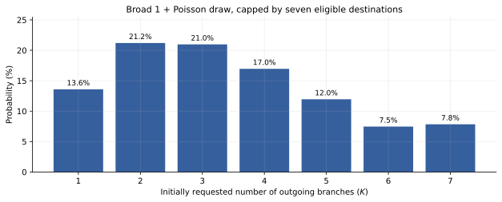
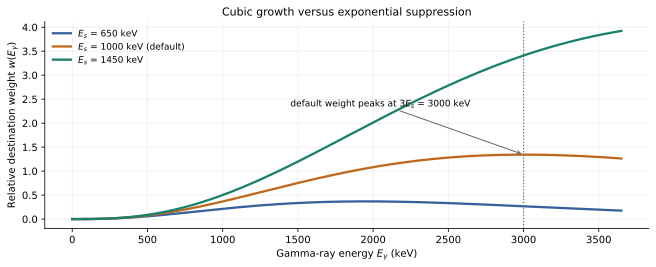
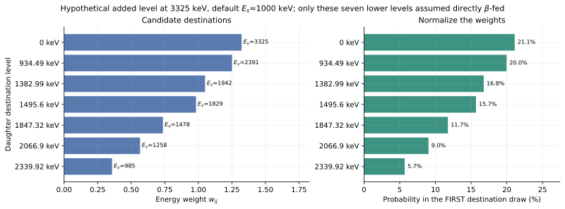
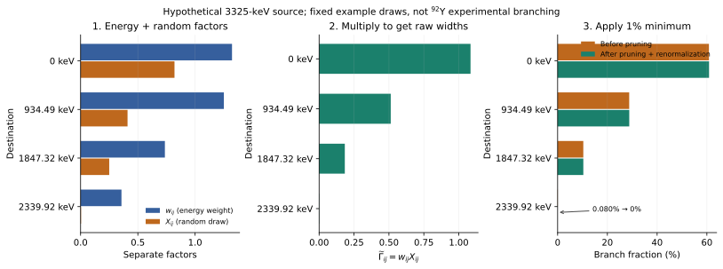
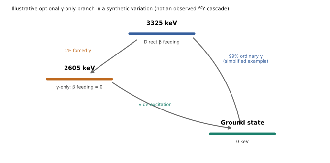

# Statistical γ-transition model

**Implemented in:** MTAS Simulation Library v1.2.3, `src/apps/GenerateDecaySchemes.cpp` (`GammaWeight`, `DrawBranchCount`, `WeightedIndex`, `Widths`, `GenerateGammas`, `FrozenGammaOnly`, `GammaOnlyStats`). Verified source SHA-256: `889ab065aa1f26f2ace49059f8b404d082850693975212594aa89774d78a360f`.

This chapter explains how **a hypothetical γ-decay network** is generated *after* the daughter-level energies and direct β feeding are known. It does **not** simulate the response of MTAS to individual γ rays; that happens later in `GenerateResponse`. The only currently supported γ-network model is `strength_weighted_sparse`.

The model is **phenomenological**: it creates variable, downward γ cascades without calculating spins, multipolarities, nuclear transition matrix elements, or a microscopic photon-strength function. Its numerical choices are model assumptions, not evaluated nuclear data.

## The task: construct one γ-decay network

Suppose β decay populates an excited daughter level. It must de-excite by one or more γ transitions in this model. For every excited level whose pattern is *not* experimentally frozen, we need to answer three questions:

1. **How many** outgoing γ branches should the level have? One, two, five, ...?
2. **To which lower levels** do these branches go? Which γ energies are preferentially selected?
3. **How strong is each selected branch?** Their branching fractions must add to 100% (within validation tolerance), but can fluctuate strongly.

The code handles these as **different random operations**. An energy-based preference for selecting a destination is not yet a γ branching intensity.

```text
Shared daughter-level skeleton + one generated β-feeding distribution
                             |
                             v
             Identify experimentally FROZEN γ patterns
                             |
                             v
            For each nonfrozen excited source level:
             (1) choose an outgoing BRANCH COUNT
                             |
                             v
             (2) choose lower DESTINATION levels
                  using γ-energy preferences
                             |
                             v
             (3) draw random PARTIAL WIDTHS
                             |
                             v
              Normalize, remove branches below 1%,
                      and renormalize
                             |
                             v
            Check γ-only constraints and validate
                             |
                             v
                Write positive branches to XML
```

### The model at a glance

| Question | Rule in v1.2.3 | Default or consequence |
|---|---|---|
| Which γ model? | `gamma.model = strength_weighted_sparse` | Only supported model |
| Which lower levels are ordinarily eligible? | Ground state + lower levels with **positive direct β feeding** | Not every energetically possible transition |
| How many branches? | `1 + Poisson(3H−1)` with random multiplier `H` and limits | `H` uniform from 0.55 to 1.8; cap 15 |
| Which destinations? | Sample without replacement using an energy weight | `Eγ³ exp(−Eγ/Es)`, `Es=1000` keV |
| How strong are selected branches? | Multiply weights by gamma-distributed random factors | Mathematical gamma distribution, shape **0.5** |
| What happens to weak branches? | Remove positive synthetic branches below 1%, renormalize | Can finish with fewer branches than initially drawn |
| What happens to experimental γ patterns? | Preserve both destinations **and** intensities by default | They are not resampled |
| Can some excited levels be γ-only fed? | Inherited from fixed data or optionally synthesized | Special constraints and forced connections |

## Step 1 — Understand which destinations are possible

Number the daughter levels in **increasing** excitation energy: the ground state is level `0`, level `1` is the first excited level, and so on. Let `i` be a particular *source* level and `j` one of its lower *destination* levels. Energetically, the γ energy is simply

\[
E_{\gamma,ij}=E_i-E_j,\qquad E_j<E_i.
\]

It is tempting to assume that any lower level can be reached. **That is not the implemented rule for an ordinary generated branch.** The available destinations are

\[
D_i=\{\text{ground state}\}\cup
\{\text{lower excited levels with nonzero direct beta feeding}\}.
\]

A lower level receiving *only γ feeding* is normally **not** offered as an ordinary generated destination. There are two exceptions: a **forced synthetic γ-only destination** and a **frozen experimental transition**, both described later.

For an actual generated scheme, the β-feeding model has already decided which levels receive direct feeding. That selection therefore also influences the γ network: **changing β feeding can change which γ connections are possible.**

The program precomputes weights for *all* energetically downward pairs in the skeleton, but that table is not a declaration that all those connections will be used.

## Step 2 — How many γ branches are requested?

Let `mγ` be `gamma.mean_outgoing_branches` (default **3**). For one generated source level, the code draws:

\[
H\sim\operatorname{Uniform}(0.55,1.8),\qquad
\mu=H\,m_\gamma,
\]

followed by

\[
K_{\mathrm{raw}}=1+\operatorname{Poisson}(\max(0,\mu-1)).
\]

A **Poisson distribution** generates an integer, here interpreted as the additional number of γ branches beyond the mandatory first branch. The independently drawn `H` makes the effective Poisson parameter vary from level to level. Thus `mean_outgoing_branches = 3` does **not** imply exactly three outgoing transitions, or even a final average of exactly three.

The requested count is then capped by the number of available destinations, `max_outgoing_branches_per_level` (default **15**), and the largest count consistent with the minimum branch intensity (default **1%**):

\[
K=\min\!\left(K_{\mathrm{raw}},\,|D_i|,\,15,\,\lfloor 100/1\rfloor\right)
\quad\text{for the default configuration.}
\]

At least one branch is required from an ordinary generated excited level. Additional handling applies when **forced γ-only** links are requested.



This example has seven eligible lower levels. The final bar includes draws capped to **seven**; it is *not* the probability that a standard Poisson variable is exactly seven. The calculation averages the stated Poisson law over `H` from 0.55 to 1.8. A later pruning step may remove weak branches, so the *final* count may be lower than shown.

## Step 3 — Which lower levels are selected?

For each eligible destination `j`, the code computes the energy difference `Eγ = Ei − Ej` and assigns a positive **destination-selection weight**:

\[
\boxed{w_{ij}=\left(\frac{\max(E_{\gamma,ij},1\ \mathrm{keV})}{1000\ \mathrm{keV}}\right)^3
\exp\left(-\frac{E_{\gamma,ij}}{E_s}\right)}.
\]

The default scale is `Es = gamma.energy_scale_keV = 1000` keV. The `max` with 1 keV guards very small energy differences. A further code-level lower limit of `10⁻¹⁶` prevents a numerical zero weight.

### Why does the weight have that shape?

The factor **`Eγ³` initially increases** with transition energy, while the exponential **suppresses very large γ energies**. Their competition makes the weight largest around `Eγ = 3Es` (3000 keV for the default setting).



This is a **chosen phenomenological preference**. The cubic power resembles familiar electromagnetic energy dependence, but the program does not identify E1/M1/E2 multipolarities or compute their strengths. The exponential scale is also a user-configured model parameter, not a measured transition rate.

### Worked example: a hypothetical level in ⁹²Zr

Take a *hypothetical generated* daughter source at **3325 keV** and suppose the seven lower levels shown below are directly β-fed. All are lower than the source, so each is an ordinary candidate. They use the excitation energies of the lower states in the supplied ⁹²Zr example. This **is not** an experimental γ cascade from the 3325-keV level.

| Destination `Ej` (keV) | γ energy `Ei − Ej` (keV) | Energy weight `wij` | Chance in the **first** destination draw |
|---:|---:|---:|---:|
| 0.00 | 3325.00 | 1.322 | 21.1% |
| 934.49 | 2390.51 | 1.251 | 20.0% |
| 1382.99 | 1942.01 | 1.050 | 16.8% |
| 1495.60 | 1829.40 | 0.983 | 15.7% |
| 1847.32 | 1477.68 | 0.736 | 11.7% |
| 2066.90 | 1258.10 | 0.566 | 9.0% |
| 2339.92 | 985.08 | 0.357 | 5.7% |

For any individual draw, if `A` is the set of destinations **not yet selected**, then

\[
P(\text{choose destination }j\text{ next})=\frac{w_{ij}}{\sum_{\ell\in A}w_{i\ell}}.
\]



The program selects destinations **without replacement**. After one is drawn, it removes it from the candidate pool and normalizes the remaining weights again until it has selected `K` destinations.

**Crucially:** a **21.1% first-draw probability does *not* mean a 21.1% γ branching intensity.** It tells us only how often the ground-state destination would win the **first selection** in this illustrative setup. The next step independently determines *intensities*.

## Step 4 — How strong is each selected γ branch?

Once the destinations have been chosen, the program draws an independent random positive value for each outgoing transition:

\[
X_{ij}\sim\operatorname{Gamma}(k=0.5,\mathrm{scale}=1),
\]

where `Gamma` names a **mathematical probability distribution**, not a gamma-ray particle. Its shape of **0.5** produces many small values and occasional large values. This gives *Porter–Thomas-like* fluctuations; the code does **not** calculate nuclear wave functions or derive these numbers from microscopic structure.

A selected transition receives a **raw partial-width proxy**

\[
\widetilde\Gamma_{ij}=w_{ij}X_{ij}.
\]

The raw numbers have no absolute lifetime meaning; the program needs only their *relative sizes*. It normalizes them to obtain an initial branching fraction:

\[
\boxed{b_{ij}=\frac{\widetilde\Gamma_{ij}}{\sum_{\ell\ \mathrm{selected}}\widetilde\Gamma_{i\ell}}}.
\]

### Why reuse `wij` after using it to select destinations?

There are two deliberate, separate biases: high-weight transitions are **more likely to be included**, and—*if included*—tend to have **larger branching intensities**, albeit with substantial fluctuations from `Xij`. This double use is part of the v1.2.3 statistical model, not a physics theorem.

### Example: multiply, normalize, prune

For four selected destinations from our hypothetical 3325-keV source, take these **illustrative** random values:

| Destination (keV) | Weight `wij` | Random `Xij` | Raw width `wij Xij` | Initial γ intensity | Final γ intensity |
|---:|---:|---:|---:|---:|---:|
| 0.00 | 1.322 | 0.820 | 1.084 | 60.82% | 60.87% |
| 934.49 | 1.251 | 0.410 | 0.513 | 28.77% | 28.80% |
| 1847.32 | 0.736 | 0.250 | 0.184 | 10.32% | 10.33% |
| 2339.92 | 0.357 | 0.004 | 0.00143 | **0.080%** | **0% — removed** |



By default, the model requires every **nonzero generated** γ branch to have an intensity of at least **1%**. The weak 0.080% branch is therefore **removed**, and the other three are renormalized to sum to 100%.

The source implementation repeats this pruning/renormalization until no remaining positive branch is below the threshold (or a single branch remains). Consequently a level that initially draws four destinations can finish with only three, two, or one positive γ branches. If only one survives, it has 100% intensity.

This differs from the **β-intensity** minimum described in [β-feeding models](BetaFeedingModels.md): undersized β branches are **retained at a minimum positive intensity**; undersized synthetic γ branches are **removed**.

## Step 5 — Preserve trusted experimental transitions

The preceding steps apply only to levels whose γ pattern is generated. With the default

```ini
[preservation]
freeze_known_gamma_patterns = true
```

**known experimental daughter levels keep their recorded outgoing γ transitions and their recorded branching fractions.** The program does *not* apply the synthetic 1% floor or the synthetic 15-branch limit to these frozen patterns. It copies relevant transition attributes, including conversion coefficients if present as XML metadata. `Type="Fake"` transitions are ignored.

This is worth emphasizing because the β model behaves differently: **known direct β feedings must stay nonzero by default but their intensities can change**; **known γ transition destinations and intensities are both frozen** under this setting.

If `freeze_known_gamma_patterns = false`, the program regenerates **both** their destinations and intensities using the statistical model. There is currently **no** implemented option that fixes the existing experimental destination topology but varies only its γ branching intensities. That would require a future code modification.

## Step 6 — Special case: γ-only-fed excited levels

An excited level may receive **zero direct β feeding** but be reached through a γ transition from a higher state. This is called a *γ-only-fed level*. The ground state is excluded from this category.

### Existing γ-only levels inherited from experimental data

With frozen experimental γ patterns, the generator propagates the **original** direct β feeding through all positive frozen γ branches. Any reachable excited state without original direct β feeding is marked as an *inherited* γ-only-fed level.

These levels remain protected against new direct β feeding. When such a set is inherited, the generator does **not** invent additional random γ-only targets; the usual synthetic count and population-fraction caps do not apply to the inherited set. The default `frozen_gamma_only_overrides_constraints = true` is required by this version.

### Optional synthetic γ-only levels

When there is no inherited override, the configuration can request an additional category:

```ini
[gamma_only]
probability_per_variation = 0.30
max_levels = 2
max_cascade_fraction = 0.10
```

With **30% probability per attempted variation**, the generator tries to create between one and two new γ-only-fed excited levels (subject to eligibility and retry constraints). It selects eligible *added* levels, protects them from direct β feeding, and chooses a higher directly β-fed nonfrozen source for each.

For each such source it forces a link to the requested γ-only target. The forced branch is ultimately assigned exactly the **minimum γ branch** (1% by default), while one or more *ordinary* branches share the remainder.



The diagram is simplified. A forced γ-only state need not decay directly to the ground state, and the higher source may have multiple ordinary outgoing branches.

### What does the 10% cascade limit mean?

It limits the **fraction of complete β–γ cascades** that pass through *at least one* γ-only-fed excited level; it does **not** sum the populations of each γ-only level. A cascade passing through two of them counts **once**.

More precisely, if `G` is the set of γ-only-fed excited levels, let `q_i` be the probability that a γ cascade starting at level `i` visits at least one member of `G`. Downward recursion gives

\[
q_i=\begin{cases}
1, & i\in G,\\
\sum_{j<i}b_{ij}q_j, & i\notin G.
\end{cases}
\qquad
P_{\gamma\text{-only}}=\sum_i B_i q_i,
\]

where `B_i` is the **direct β fraction** populating level `i`, distinct from the γ fraction `b_ij`.

The synthetic cap requires `Pγ-only ≤ 0.10` and no more than two γ-only-fed excited levels under the supplied defaults. Unfeasible or invalid attempted variations are rejected and redrawn within the configured retry bound. Hence `probability_per_variation = 0.30` does **not** guarantee that exactly 30% of accepted schemes have an additional γ-only component.

## Final checks, limits, and interpretation

After constructing the network, the code checks that γ transitions go strictly downward, generated positive branches satisfy their minimum, and generated excited levels have valid outgoing transitions. γ branching sums must be near unity; directly β-fed excited levels have an additional stricter first-γ normalization check. The output omits generated zero-intensity branches and unreachable levels. For detailed tolerances, complete validation, and cascade counting, see [scheme construction and validation](DecaySchemeValidation.md).

**What the model does not do:** use nuclear spin/parity selection rules for the generated γ network, calculate E1/M1/E2 reduced rates, simulate conversion-electron emission, predict experimental lifetimes, or enforce a known γ-multiplicity distribution. Its random choices are *ensemble assumptions* that should be validated for a scientific application.

**Related:** [β-feeding models](BetaFeedingModels.md), [scheme construction/validation](DecaySchemeValidation.md), [GenerateDecaySchemes reference](../programs/GenerateDecaySchemes.md), and [configuration](../reference/Configurations.md).
